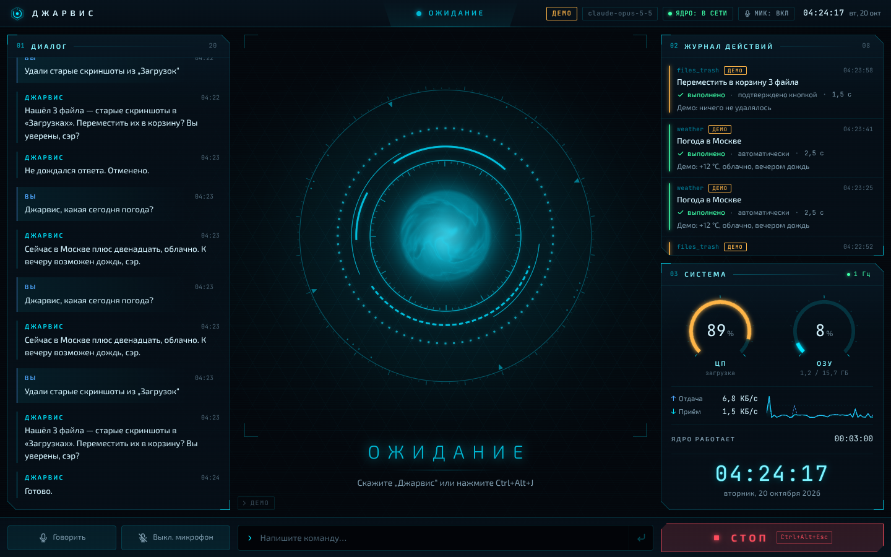
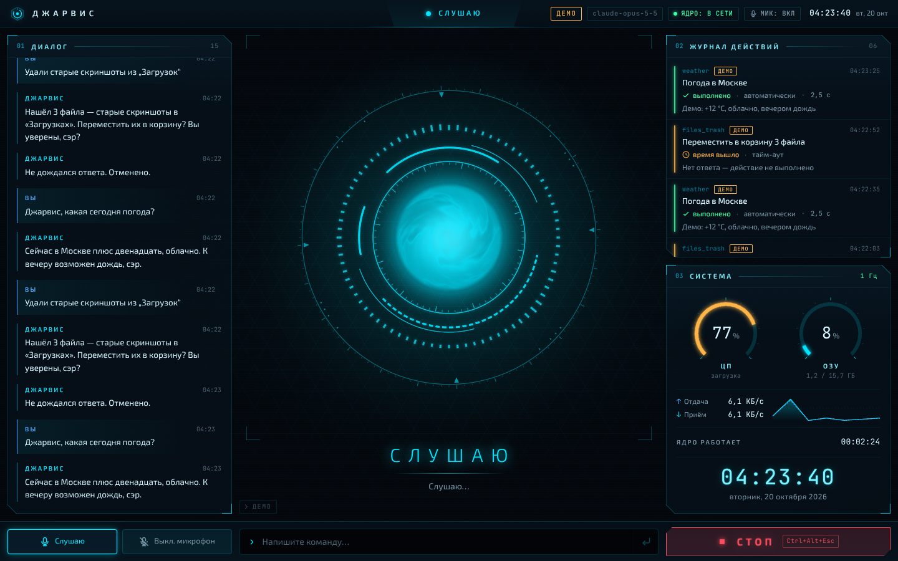
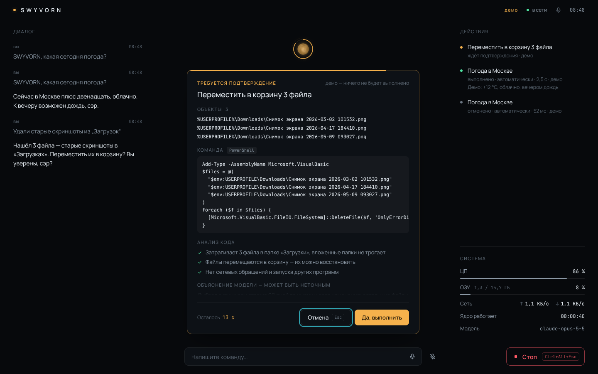

# SWYVORN

Персональный голосовой ИИ-ассистент для Windows 11: говорит и понимает по-русски, думает с помощью Claude API, живёт в трее и вызывается горячей клавишей или словом «SWYVORN».

[](https://github.com/alexei13-coder/voiceassistant/actions/workflows/ci.yml)
[](https://github.com/alexei13-coder/voiceassistant/actions/workflows/build-windows.yml)

Устроен из трёх частей: **ядро** на Python (вся логика), **оболочка** на Rust/Tauri 2 (трей, горячие клавиши, запуск ядра) и **интерфейс** на React (HUD в стиле «Железного человека»). Подробности — в [docs/architecture.md](docs/architecture.md).

## Текущий статус

**Этап 1: каркас и интерфейс, демо-режим.** «Мозга» и голоса ещё нет: ядро проигрывает демонстрационный сценарий — «слушает», «думает», отвечает, просит подтвердить «опасное» действие, — чтобы проверить интерфейс и связь частей между собой. **Никаких реальных действий не выполняется**, все демо-записи в журнале помечены «ДЕМО».

Что уже работает: HUD с анимированным ядром, диалог, журнал действий, системные метрики (ЦП, память, сеть), ввод текста (с демо-ответом), кнопка «Стоп» и аварийная остановка, трей (и автозапуск при входе в Windows — по желанию), глобальные горячие клавиши, автоматический перезапуск упавшего ядра, сборка установщика для Windows в CI.

| Этап | Что появится | Статус |
|---|---|---|
| 1 | Каркас: ядро, оболочка, HUD, протокол, демо-сценарий, CI и установщик | **идёт сейчас** |
| 2 | «Мозг»: диалог через Claude API, память о пользователе, вопрос «как к вам обращаться» при первом запуске | запланирован |
| 3 | Голос: слово-триггер «SWYVORN», распознавание и синтез русской речи, голосовой «Стоп», повтор ответа | запланирован |
| 4 | Инструменты и безопасность: плагины, уровни риска, подтверждения, анализ экрана | запланирован |
| 5 | Доводка: стабильность и удобство; состав уточним по итогам этапов 1–4 | запланирован |

## Скриншоты

| Ожидание | Слушаю | Подтверждение действия |
|---|---|---|
|  |  |  |

## Быстрый старт без установки инструментов

Готовый установщик собирает GitHub Actions при каждом изменении веток `main` и `stage-*`.

1. Войдите в GitHub (без входа артефакты не скачиваются).
2. Откройте [Actions → «Сборка для Windows»](https://github.com/alexei13-coder/voiceassistant/actions/workflows/build-windows.yml) и выберите последний успешный запуск (зелёная галочка).
3. Внизу страницы, в разделе **Artifacts**, скачайте **swyvorn-windows-installer** и распакуйте архив.
4. Запустите `Swyvorn_…_x64-setup.exe`. Права администратора не нужны: приложение ставится только для текущего пользователя.
5. Windows покажет предупреждение SmartScreen «Система Windows защитила ваш компьютер» — приложение пока не подписано сертификатом. Нажмите **«Подробнее» → «Выполнить в любом случае»**.

Без установки: скачайте артефакт **swyvorn-windows-portable**, распакуйте в любую папку и запустите `Swyvorn.exe`. Папка `core` должна лежать рядом с `Swyvorn.exe` — в ней ядро ассистента.

Артефакты хранятся 14 дней. Если они истекли, владелец репозитория может пересобрать их кнопкой **Run workflow** на той же странице.

## Разработка на Windows

### Что установить

| Инструмент | Где взять | Через winget |
|---|---|---|
| Git | [git-scm.com](https://git-scm.com/download/win) | `winget install --id Git.Git -e` |
| uv (Python и зависимости ядра) | [docs.astral.sh/uv](https://docs.astral.sh/uv/getting-started/installation/) | `winget install --id astral-sh.uv -e` |
| Node.js 22 LTS или новее | [nodejs.org](https://nodejs.org/) | `winget install --id OpenJS.NodeJS.LTS -e` |
| Rust (через rustup) | [rustup.rs](https://rustup.rs/) | `winget install --id Rustlang.Rustup -e` |
| Microsoft C++ Build Tools | [visualstudio.microsoft.com](https://visualstudio.microsoft.com/visual-cpp-build-tools/) — в установщике отметьте рабочую нагрузку **«Разработка классических приложений на C++»** | — |

WebView2 в Windows 11 уже установлен. Python отдельно ставить не нужно: uv сам скачает Python 3.12. Официальный список требований Tauri — [v2.tauri.app/start/prerequisites](https://v2.tauri.app/start/prerequisites/).

После установки откройте **новое** окно терминала, чтобы обновился `PATH`.

### Запуск

```powershell
git clone https://github.com/alexei13-coder/voiceassistant.git
cd voiceassistant
scripts\start-dev.bat
```

Или просто дважды щёлкните `scripts\start-dev.bat` в Проводнике. Скрипт проверит инструменты (и подскажет, как поставить недостающие), установит зависимости ядра (`uv sync`) и интерфейса (`npm ci`, если ещё не установлены) и запустит `npm run tauri dev`. Отладочная оболочка сама запускает ядро из исходников через uv — отдельно его запускать не нужно. Первая сборка Rust занимает 5–10 минут, дальше — секунды.

Отладочная копия запускается со своим идентификатором («SWYVORN dev», `ui\src-tauri\tauri.dev.conf.json`), поэтому не конфликтует с установленным SWYVORN как второй экземпляр. Но глобальные горячие клавиши достанутся той копии, что запущена первой: если установленный SWYVORN уже работает, скрипт предупредит об этом — закройте его (трей → «Выход»), чтобы проверять горячие клавиши в отладочной.

Не запускайте терминал «от имени администратора»: ядро с такими правами работать откажется.

### Полезные команды

Все команды — из корня репозитория, в обычном (не администраторском) окне PowerShell.

В PowerShell `npm` и `npx` вызываются как `npm.cmd` и `npx.cmd`: на чистой Windows 11 политика выполнения `Restricted` не даёт запустить их обёртки `npm.ps1` и `npx.ps1` («выполнение сценариев отключено в этой системе»). Если удобнее короткие `npm` и `npx`, один раз разрешите локальные сценарии для своей учётной записи: `Set-ExecutionPolicy -Scope CurrentUser RemoteSigned`.

```powershell
# ядро: тесты, линтер, форматирование
cd core; uv run pytest -q; uv run ruff check .; uv run ruff format .; cd ..

# интерфейс: типы, линтер, тесты
cd ui; npm.cmd run typecheck; npm.cmd run lint; npm.cmd test; cd ..

# только интерфейс со встроенной имитацией ядра: http://127.0.0.1:1420/?mock=1
cd ui; npm.cmd run dev

# оболочка: форматирование, clippy и тесты (нужен собранный интерфейс ui\dist — первая строка)
cd ui; npx.cmd vite build; cd ..
cd ui\src-tauri; cargo fmt; cargo clippy --all-targets -- -D warnings; cargo test; cd ..\..

# установщик локально: сначала ядро (core\dist\swyvorn-core), затем приложение
powershell -ExecutionPolicy Bypass -File scripts\build-core.ps1
cd ui; npx.cmd tauri build --config src-tauri/tauri.bundle.conf.json; cd ..
```

Установщик появится в `ui\src-tauri\target\release\bundle\nsis\`.

Режим имитации `?mock=1` не требует Python: интерфейс сам изображает ядро. Дополнительные параметры: `&state=listening` — зафиксировать состояние, `&confirm=1` — показать окно подтверждения.

Отладочной оболочке можно подменить команду запуска ядра переменными `SWYVORN_CORE_PROGRAM` и `SWYVORN_CORE_ARGS` (в релизной сборке они не действуют).

## Разработка в браузере (Linux/macOS)

Оболочку Tauri под Windows на Linux не проверить, но ядро и интерфейс работают где угодно. Нужны uv и Node.js 22+.

```bash
scripts/dev-browser.sh
```

Скрипт создаёт случайный токен, запускает ядро (`--dev --no-stdin --port 8765`) и Vite с тем же токеном, ждёт готовности ядра и печатает адрес: **http://127.0.0.1:1420/**. Ctrl+C останавливает оба процесса. Другой порт: `SWYVORN_DEV_PORT=8766 scripts/dev-browser.sh`.

В браузере нет трея, глобальных горячих клавиш и аварийного стопа (их даёт оболочка) — интерфейс об этом предупреждает. Без Python можно открыть имитацию: `cd ui && npm run dev`, затем http://127.0.0.1:1420/?mock=1.

Собрать ядро PyInstaller для проверки: `scripts/build-core.sh` (установщик для Windows собирает только CI).

## Настройка ключа API

На этапе 1 ключ не нужен — он понадобится с этапа 2, когда подключим «мозг».

1. Получите ключ: [console.anthropic.com](https://console.anthropic.com) → **API Keys** → **Create Key**.
2. Скопируйте образец [`.env.example`](.env.example) в файл `.env` и впишите ключ после `ANTHROPIC_API_KEY=`:
   - установленное приложение — `%APPDATA%\Swyvorn\.env`;
   - разработка — можно положить `.env` в корень репозитория (ядро читает его только в режиме `--dev`).

```powershell
Copy-Item .env.example "$env:APPDATA\Swyvorn\.env"
notepad "$env:APPDATA\Swyvorn\.env"
```

Порядок поиска: переменные окружения → `%APPDATA%\Swyvorn\.env` → `.env` в корне репозитория (только `--dev`).

**Почему не в коде.** Ключ даёт доступ к платному аккаунту: попав в коммит, он остаётся в истории git навсегда, даже если строку потом удалить. Файл `.env` уже в `.gitignore`. Ядро держит ключ только в памяти и никогда не пишет его в лог, в интерфейс или в сообщения протокола.

## Горячие клавиши

Работают во всей системе, пока запущено приложение (в браузерном режиме их нет).

| Сочетание | Действие |
|---|---|
| `Ctrl+Alt+J` | короткое нажатие — вызвать ассистента; удержание — говорить, пока держите (на этапе 1 — имитация прослушивания) |
| `Ctrl+Alt+Escape` | «Стоп»: остановить всё. Два нажатия за 2 секунды — аварийная остановка с перезапуском ядра |
| `Ctrl+Alt+Backspace` | запасной «Стоп», если основное сочетание занято другой программой |
| `Ctrl+Alt+M` | не слушать / слушать |
| `Ctrl+Alt+R` | повторить последний ответ (этап 3) |
| `Ctrl+Alt+S` | посмотреть на экран (этап 4) |

Сочетания меняются в разделе `[hotkeys]` файла `%APPDATA%\Swyvorn\settings.toml`; после правки перезапустите приложение (трей → «Выход» и запустить снова).

## Трей

Значок SWYVORN в области уведомлений: левый щелчок открывает окно, правый — меню.

| Пункт | Действие |
|---|---|
| «Показать» | открыть HUD |
| «Не слушать» | выключить / включить микрофон |
| «Стоп» | то же, что кнопка «Стоп»; два нажатия за 2 секунды — аварийная остановка с перезапуском ядра |
| «Запускать при входе в Windows» | автозапуск, **по умолчанию выключен**. Если поставить галочку, ассистент будет запускаться при входе в Windows сразу в трей, без окна. Галочка показывает, есть ли запись автозапуска в системе на самом деле |
| «Выход» | завершить ассистента вместе с ядром (крестик окна только прячет его в трей) |

Запись автозапуска указывает на тот `Swyvorn.exe`, из которого её включили: если перенесли портативную папку, снимите и снова поставьте галочку.

## Где лежат данные и логи

| ОС | Папка данных |
|---|---|
| Windows | `%APPDATA%\Swyvorn\` |
| Linux (разработка) | `$XDG_CONFIG_HOME/swyvorn/` или `~/.config/swyvorn/` |
| macOS (разработка) | `~/Library/Application Support/Swyvorn/` |

Внутри:

```
settings.toml      настройки — создаётся с комментариями при первом запуске
.env               секреты (ключ API)
logs/core.log      лог ядра: ротация 1 МБ × 5 файлов, секреты вырезаны
logs/shell.log     лог оболочки (трей, горячие клавиши, запуск ядра)
```

Позже (с этапа 2) появятся `memory.json`, `contacts.toml` и `logs/audit.jsonl`. Другую папку можно задать переменной `SWYVORN_DATA_DIR`. Образец настроек со всеми ключами — [`settings.example.toml`](settings.example.toml), описание — [docs/configuration.md](docs/configuration.md). При удалении приложения папка данных сохраняется; если она не нужна, удалите её вручную.

## Безопасность

Ассистент будет управлять компьютером, поэтому правила заложены с первого этапа. Сами инструменты появятся на **этапе 4**; сейчас все действия демонстрационные.

- **Уровни риска.** Каждое действие получает уровень, и решает это код ядра, а не модель:
  - **SAFE** — безопасное (узнать погоду, открыть сайт): выполняется сразу и записывается в журнал;
  - **CONFIRM** — рискованное (удалить файлы, отправить сообщение): ассистент озвучивает, что собирается сделать, и ждёт «да» голосом или кнопкой 15 секунд; молчание — отмена. Для самых опасных действий голоса недостаточно — только кнопка, и это проверяет ядро: «да» голосом или текстом оно не примет;
  - **FORBIDDEN** — запрещённое: не выполняется никогда.
- **Кнопка «Стоп»** (и `Ctrl+Alt+Escape`, и пункт трея) за доли секунды отменяет всё текущее: ответ, речь, инструмент, ожидающее подтверждение. Если ядро не отвечает, процесс ядра убивается целиком и перезапускается: кнопка в HUD делает это сама, если ядро не отреагировало за секунду, а горячая клавиша и трей — по второму нажатию за 2 секунды.
- **Журнал действий** в HUD показывает каждое действие: что, с каким риском, кто подтвердил, чем закончилось.
- **Без прав администратора.** Ядро отказывается запускаться с правами администратора, установщик ставит приложение только для текущего пользователя.
- **Ключ API** никогда не попадает в лог, интерфейс и протокол. Прочитав ключ и токен связи с интерфейсом, ядро убирает их из своих переменных окружения, чтобы их не унаследовали запущенные им программы.
- **Только локально.** Интерфейс общается с ядром через `127.0.0.1` со случайным токеном, который создаётся при каждом запуске, и с проверкой Origin — сайты и посторонние программы подключиться не могут.

## Как добавить свой инструмент

> Появится на этапе 4. Ниже — предварительный контракт, детали могут измениться.

Каждый инструмент — отдельный модуль в `core/swyvorn/plugins/`. Модуль описывает:

| Часть | Зачем |
|---|---|
| `name` | машинное имя, например `weather` |
| `description` | что делает инструмент — по этому описанию модель решает, когда его вызвать |
| схема аргументов | строгая модель pydantic (лишние поля запрещены): модель не сможет передать то, чего вы не ждёте |
| базовый риск | `SAFE`, `CONFIRM` или `FORBIDDEN` |
| правило эскалации | код, который по конкретным аргументам может только повысить риск (например, удаление больше 10 файлов — подтверждение только кнопкой) |
| `describe()` | человеческое описание действия для журнала и окна подтверждения: «Переместить в корзину 3 файла» |
| `execute()` | само действие (асинхронно); его можно прервать кнопкой «Стоп» |

Набросок того, как это может выглядеть:

```python
# core/swyvorn/plugins/weather.py — набросок, API появится на этапе 4
class WeatherArgs(BaseModel):
    model_config = ConfigDict(extra="forbid", strict=True)
    city: str = Field(min_length=1, max_length=100)


class Weather(Tool[WeatherArgs]):
    name = "weather"
    description = "Погода в указанном городе на сегодня"
    base_risk = Risk.SAFE

    def describe(self, args: WeatherArgs) -> str:
        return f"Погода: {args.city}"

    async def execute(self, args: WeatherArgs) -> ToolResult: ...
```

## Структура проекта

```
core/                 ядро на Python 3.12 (uv): логика, протокол, демо-сценарий
  swyvorn/             исходники (точка входа — python -m swyvorn)
  swyvorn_entry.py     точка входа сборки PyInstaller (swyvorn-core.exe)
  tests/              тесты pytest
ui/                   интерфейс: React 19 + TypeScript + Vite
  src/                HUD, клиент WebSocket, анимированное ядро (WebGL2)
  src-tauri/          оболочка на Rust (Tauri 2): трей, горячие клавиши, запуск ядра
scripts/              запуск для разработки и сборка ядра
.github/workflows/    CI (Linux + Windows) и сборка установщика
docs/                 протокол, настройки, архитектура
```

Документы: [протокол обмена](docs/protocol.md) · [настройки и файлы данных](docs/configuration.md) · [архитектура](docs/architecture.md).

## Решение проблем

**Горячая клавиша не работает или HUD сообщает, что сочетание занято.** Его уже заняла другая программа. Для «Стопа» автоматически включается запасное `Ctrl+Alt+Backspace`. Любое сочетание можно поменять в `[hotkeys]` файла `%APPDATA%\Swyvorn\settings.toml` и перезапустить приложение.

**Предупреждение SmartScreen при запуске установщика.** Приложение не подписано сертификатом, это ожидаемо: «Подробнее» → «Выполнить в любом случае».

**Где смотреть логи.** `%APPDATA%\Swyvorn\logs\core.log` — ядро, `%APPDATA%\Swyvorn\logs\shell.log` — оболочка. Быстро открыть папку: Win+R → `%APPDATA%\Swyvorn\logs`.

**Ядро постоянно перезапускается или HUD пишет, что ядро упало.** Оболочка перезапускает упавшее ядро с паузами 1, 2, 4… секунды. Если за минуту ядро упало больше 5 раз, оболочка сдаётся, и HUD показывает «Ядро не запускается: Ядро постоянно падает — смотрите logs/core.log и logs/shell.log…». Причина — в `logs\core.log` и `logs\shell.log`. Частые случаи: антивирус поместил `core\swyvorn-core.exe` в карантин (добавьте папку приложения в исключения), в портативной версии рядом с `Swyvorn.exe` нет папки `core`.

**HUD пишет «Ядро не запускается».** Ядро остановлено и само больше не поднимется (так же — если ядро не удалось запустить или оно сообщило о фатальной ошибке). Устраните причину из сообщения и логов, затем запустите ядро заново аварийным стопом: кнопка «Стоп» в HUD или два нажатия `Ctrl+Alt+Escape` (или пункта трея «Стоп») за 2 секунды. Можно и просто перезапустить приложение: трей → «Выход».

**«Ассистент нельзя запускать от имени администратора».** Запустите приложение обычным способом, без «Запуск от имени администратора».

**Пустое окно вместо HUD.** Не установлен или повреждён WebView2 — поставьте [WebView2 Runtime](https://developer.microsoft.com/microsoft-edge/webview2/).

**Разработка: `link.exe not found` при сборке Rust.** Не установлены Microsoft C++ Build Tools с нагрузкой «Разработка классических приложений на C++».

**Разработка: `Port 1420 is already in use`.** Уже запущен другой Vite (например, второй `start-dev.bat`) — закройте его.

**Разработка: PowerShell пишет, что выполнение сценариев отключено.** Запускайте через `scripts\start-dev.bat`: он разрешает выполнение только этого скрипта и не меняет политику системы. Если ошибка про `npm.ps1` или `npx.ps1` — вызывайте `npm.cmd` и `npx.cmd` (см. «Полезные команды») или один раз выполните `Set-ExecutionPolicy -Scope CurrentUser RemoteSigned`.

**Разработка: отладочная версия не регистрирует горячие клавиши.** Их уже занял установленный SWYVORN — закройте его (трей → «Выход») и перезапустите `start-dev.bat`.

## Лицензии и модели

- Лицензия кода проекта пока не выбрана: проект личный, все права у автора.
- Ответы будет давать Claude API (этап 2) — использование по условиям Anthropic, оплата по тарифу API.
- На этапе 3 для речи планируются модели Silero. Модели распознавания и синтеза ([silero-models](https://github.com/snakers4/silero-models)) распространяются по лицензии **CC BY-NC-SA 4.0** — только некоммерческое использование; для личного ассистента это подходит, для коммерческого — нужна отдельная лицензия Silero. Детектор речи [Silero VAD](https://github.com/snakers4/silero-vad) — под MIT.
- Шрифты интерфейса Manrope и JetBrains Mono — SIL Open Font License 1.1.
